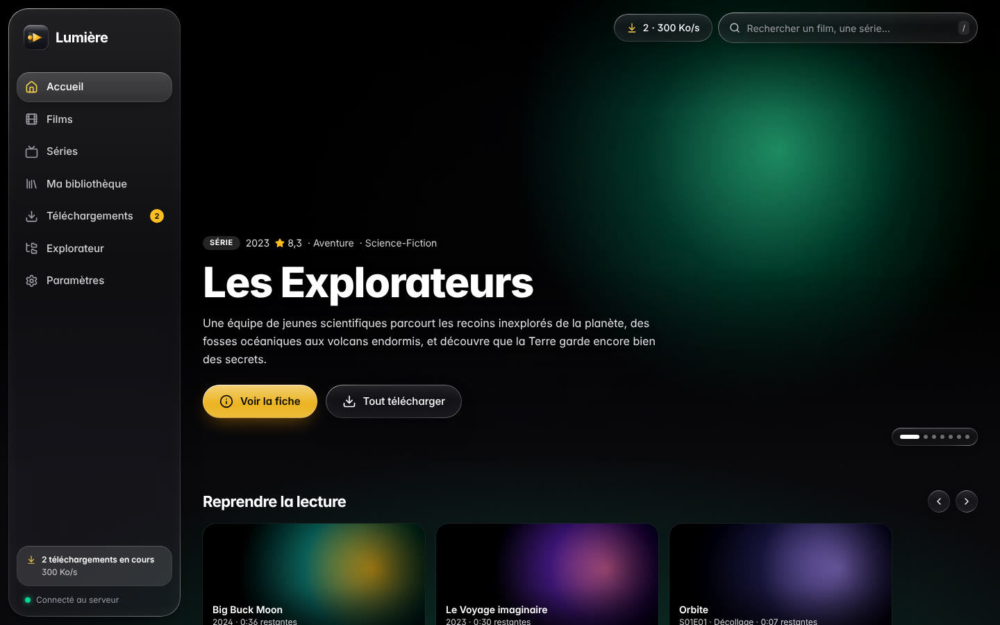
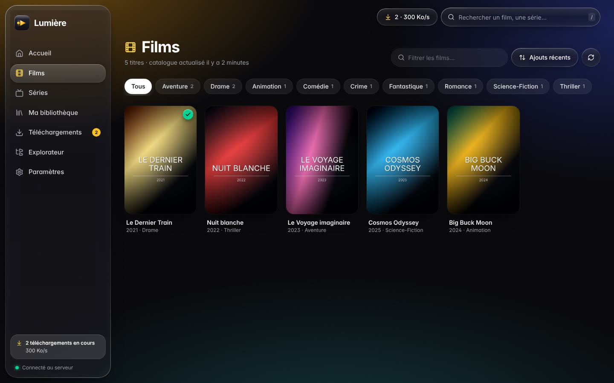
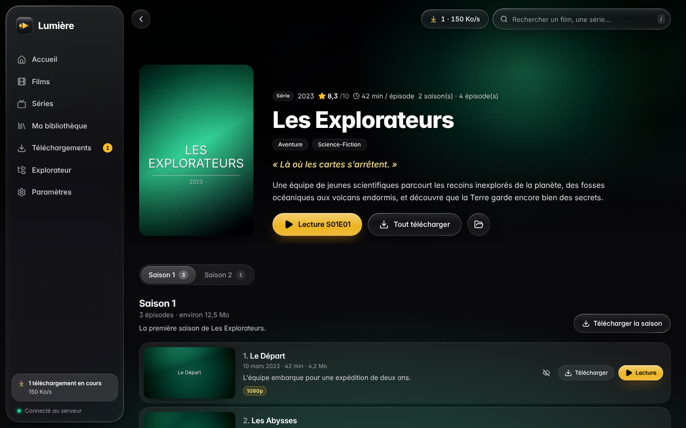
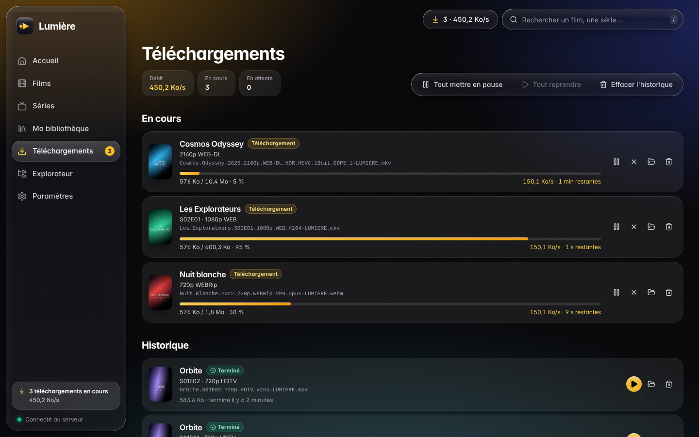
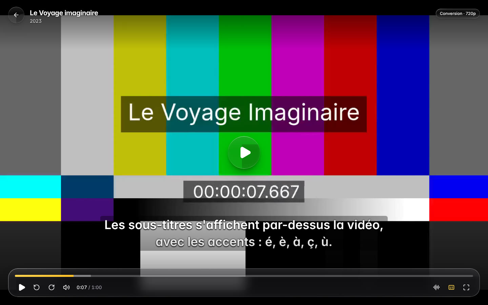
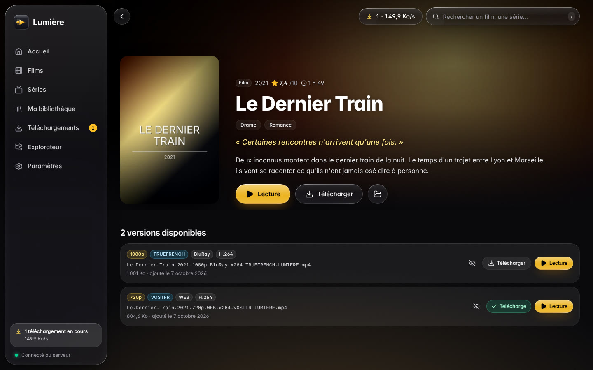
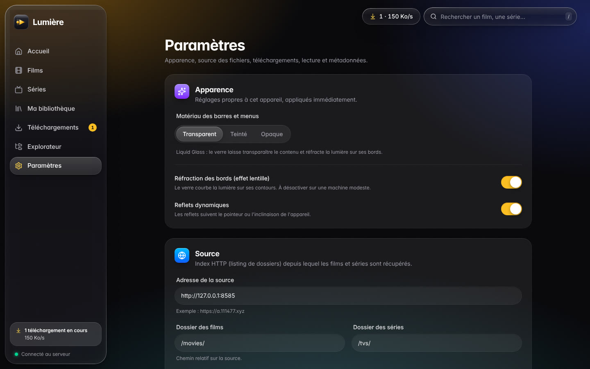
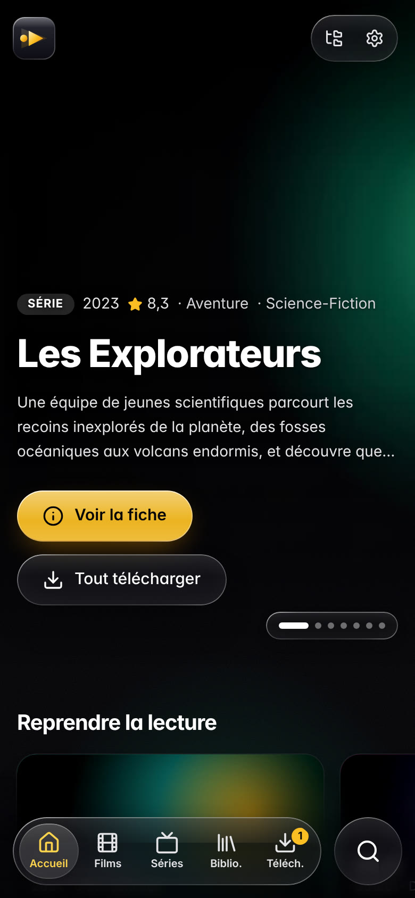
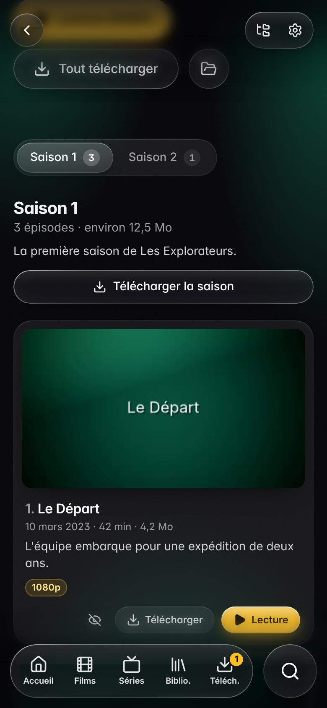

# Lumière

**Lumière** est une application pour parcourir, télécharger et regarder vos films et séries :
le catalogue vient de [TMDB](https://www.themoviedb.org), les fichiers d'une ou plusieurs
**extensions Stremio** (celle de 111477 par défaut), avec une interface au design **Liquid
Glass** inspiré d'Apple : barres et
commandes en verre qui flottent au-dessus du contenu, réfraction de la lumière sur les bords,
reflets qui suivent le pointeur, ambiance colorée par les affiches.



---

## Fonctionnalités

- **Catalogue films et séries** : tendances, titres populaires et recherche de **TMDB**, avec les
  fichiers fournis par des **extensions Stremio** — autant que vous voulez, par ordre de
  préférence : leurs versions sont réunies sur chaque fiche, et quand plusieurs proposent le même
  fichier, la suivante prend le relais si le lien de la première est refusé. Recherche
  instantanée (sans accents ni majuscules), tri par **popularité** comme sur la page
  « Populaires » de TMDB (par défaut, accueil compris) ou par sorties récentes, titre, année,
  note, filtre par genre, défilement infini.
- **Fiches détaillées** : affiche, image de fond, résumé, note, genres, durée, accroche
  (via TMDB, facultatif) ; toutes les **versions** disponibles avec leurs caractéristiques
  (4K, HDR, Dolby Vision, H.265, DD+ 5.1, MULTi, VFF, VOSTFR…) ; **saisons et épisodes** avec
  titres, résumés et vignettes.
- **Téléchargements** : file d'attente persistante, plusieurs téléchargements en parallèle,
  **pause / reprise** (même après un redémarrage, sans repartir de zéro), nouvelles tentatives
  automatiques, limite de débit, progression en temps réel ; téléchargement d'un film, d'un
  épisode, d'une saison ou d'une série entière.
- **Bibliothèque locale** rangée automatiquement (`Films/…`, `Séries/<série>/Saison 01/…`),
  lecture hors ligne, suppression, enregistrement d'un fichier sur l'appareil qui consulte
  l'interface (téléphone, autre PC).
- **Lecteur vidéo intégré** : lecture directe quand c'est possible, sinon **conversion à la
  volée avec ffmpeg** (MKV, HEVC 10 bits, HDR, AC3/DTS…), choix de la **piste audio** (français
  sélectionné automatiquement dans les releases MULTi), **sous-titres** intégrés, externes ou
  **trouvés en ligne** (OpenSubtitles.com, extensions Stremio de sous-titres comme OpenSubtitles
  v3 : ceux faits pour votre fichier exact passent en tête), décalage des sous-titres réglable,
  **reprise là où vous vous étiez arrêté**, **épisode suivant** automatique, plein écran,
  raccourcis clavier. On peut regarder **sans télécharger** (streaming depuis le lien de
  l'extension) ou depuis la copie locale.
- **Design Liquid Glass** : barre latérale flottante sous laquelle les illustrations
  s'étendent, barre d'onglets mobile qui se réduit au défilement (comme iOS 26), menus et
  dialogues en verre, contrôles segmentés à goutte « liquide », lecteur aux commandes
  flottantes. Réglage **Apparence** (Transparent, Teinté, Opaque) et respect des réglages
  d'accessibilité du système (transparence et animations réduites, contraste élevé).
- Interface **100 % en français**, thème sombre, adaptée au **mobile**, installable comme
  application (PWA), mise à jour **en temps réel**.

|                                                                |                                                               |
| -------------------------------------------------------------- | ------------------------------------------------------------- |
|                           |                  |
|  |         |
|                      |           |
|                   |  |

> Les captures proviennent de la démonstration hors ligne incluse (`npm run demo`) : vidéos
> et affiches de test générées par ffmpeg.

---

## Démarrage rapide

### 1. Prérequis

| Logiciel                  | Version                                  | Installation                                                                                               |
| ------------------------- | ---------------------------------------- | ---------------------------------------------------------------------------------------------------------- |
| **Node.js**               | 22.22 ou plus récent (24 LTS recommandé) | <https://nodejs.org>                                                                                       |
| **ffmpeg** (avec ffprobe) | 5 ou plus récent                         | Windows : `winget install Gyan.FFmpeg` · macOS : `brew install ffmpeg` · Linux : `sudo apt install ffmpeg` |

ffmpeg sert à analyser et convertir les vidéos que le navigateur ne sait pas lire. Sans lui,
l'application fonctionne mais ne lit que les fichiers directement compatibles.

### 2. Installation et lancement

```bash
git clone https://github.com/antoineferrero-eng/Video.git lumiere
cd lumiere
npm install
npm run build
npm start
```

Ouvrez ensuite **<http://localhost:8484>**. Au premier lancement, une carte de bienvenue indique
ce qu'il reste à renseigner (clé TMDB, extension Stremio), avec les liens pour les obtenir, et
mène directement au bon endroit des paramètres.

### 3. Ajouter une clé TMDB (indispensable)

Créez un compte gratuit sur [themoviedb.org](https://www.themoviedb.org/settings/api), copiez
la « clé d'API » et collez-la dans **Paramètres → Sous-titres et clés → Clés d'API** (bouton
« Obtenir une clé »). C'est TMDB qui fournit le catalogue : sans clé, il reste vide ; dès la clé
enregistrée, le catalogue est importé. La clé apporte aussi affiches, résumés et
titres d'épisodes.

### 4. Choisir les extensions Stremio

Par défaut, Lumière demande les liens des fichiers à l'extension Stremio de 111477
(`https://st.111477.xyz/manifest.json`). Dans **Paramètres → Sources → Extensions Stremio**,
ajoutez d'autres extensions par leur lien d'installation (`stremio://…` ou
`https://…/manifest.json`, configuration comprise), rangez-les par ordre de préférence avec les
flèches, et vérifiez chacune avec **Tester**. Si vous avez configuré celle de 111477 sur
[st.111477.xyz](https://st.111477.xyz/) (nombre de liens par titre, serveurs…), remplacez
l'adresse par défaut par le lien obtenu.

### 5. Sous-titres en ligne (facultatif)

Sans réglage, Lumière cherche les sous-titres manquants avec l'extension Stremio
**OpenSubtitles v3** (gratuite, sans clé) quand vous ouvrez le menu des sous-titres du lecteur,
ou d'office si la langue de sous-titres préférée manque dans le fichier. Pour des résultats
calés sur votre fichier exact, créez une clé gratuite sur
[opensubtitles.com](https://www.opensubtitles.com/consumers) (rubrique « API consumers ») et
collez-la dans **Paramètres → Sous-titres et clés**, avec votre compte pour plus de
téléchargements par jour. D'autres extensions de sous-titres compatibles s'ajoutent par leur lien.
Lors d'une recherche, l'identifiant IMDb du titre, le nom et l'empreinte du fichier sont envoyés à
ces services ; videz la liste des extensions et la clé pour n'en contacter aucun.

### 6. Sites (loadix.fun…) et 1fichier premium (facultatif)

Pour un site qui donne des liens 1fichier mais impose une vérification anti-robot (loadix.fun,
par exemple), Lumière ne lit pas le site : c'est **vous** qui le consultez dans votre
navigateur, et Lumière prend la main une fois le lien 1fichier obtenu.

1. **Paramètres → Sources → Sites** : ajoutez le site (nom et adresse). Le bouton **Ajouter loadix.fun** prépare sa recherche
   (`https://loadix.fun/search?q={titre}&type={type_en}`). Pour un autre site, faites une
   recherche, copiez l'adresse et remplacez-y le titre cherché par `{titre}` (autres repères :
   `{titre_original}`, `{annee}`, `{tmdb}`, `{imdb}`, `{type}` « film »/« serie », `{type_en}`
   « movie »/« series »).
2. Collez la **clé d'API de votre compte 1fichier premium** (1fichier.com → Mon compte →
   Paramètres → API) et vérifiez-la avec **Tester la clé**.
3. Glissez le bouton **« Envoyer à Lumière »** dans la barre de favoris de votre navigateur
   (facultatif).

### Sur la fiche d'un film ou d'une série

- **Sur le disque** : ce que vous avez déjà (téléchargé, en cours, ou déposé dans la
  bibliothèque), avec **Lecture**. Aucune source n'est interrogée à l'ouverture de la fiche.
- **Télécharger** (le film, ou la saison choisie pour une série) : choisissez la source.
  - **Extensions Stremio** : « Meilleure version » ou « Choisir une version » pour un film ;
    « Toute la saison » ou « Épisode par épisode » pour une série (aussi pour regarder en
    streaming).
  - **Un site** (loadix.fun…) : **Chercher sur …** ouvre le site sur la recherche du titre, et
    une fenêtre de Lumière vous guide : passez la vérification, choisissez la version (la
    saison complète pour une série), copiez le lien 1fichier, revenez et faites **Ctrl+V**. Le
    favori **« Envoyer à Lumière »** évite le copier-coller.

Lumière vérifie le lien (nom, taille), le rattache au film ou à la saison d'où vous êtes parti,
puis le télécharge sur le serveur : lien direct demandé à l'API 1fichier, plusieurs morceaux en
parallèle, reprise. Une **saison complète en archive .zip** est rangée épisode par épisode :

- archive non compressée (le cas habituel pour des vidéos) : ses épisodes se téléchargent un
  par un, à cocher, et se **regardent directement dans l'archive** (bouton ▶), sans rien
  télécharger ;
- archive compressée : téléchargée en entier, puis décompressée dans le dossier de la saison.

Les archives RAR ou 7z sont téléchargées telles quelles. Un lien se colle aussi depuis
**Téléchargements → Lien 1fichier**, ou n'importe où dans Lumière.

### Avec Docker

```bash
docker compose up -d --build
```

L'image contient Node.js et ffmpeg. Les données sont conservées dans `./data` et les
téléchargements dans `./media` (voir [`docker-compose.yml`](docker-compose.yml)).

### Essayer sans connexion : la démonstration

```bash
npm run build
npm run demo
```

Génère des vidéos d'exemple (films, séries, MKV multi-pistes, HEVC HDR, sous-titres…), lance
un faux service TMDB et deux fausses extensions Stremio (« Lumière démo » et « Miroir démo » :
liens qui expirent, réserve de liens limitée, fichiers en partie communs), puis l'application
sur <http://localhost:8484> avec une base dédiée (`data/demo`). `DEMO_MAX_CONNECTIONS=2 npm run
demo` limite les connexions simultanées à un même fichier, comme un hébergeur strict (pour
éprouver les positionnements du lecteur). Un faux 1fichier (compte premium, clé `demo`) et un
faux site de liens (avec des saisons complètes en .zip) servent les sites : ajoutez le site
`http://127.0.0.1:8585/site-demo/?q={titre}`.

---

## Configuration

La plupart des réglages se font dans l'interface (**Paramètres**), rangés en cinq onglets :

| Onglet                  | Contenu                                                                                                                                                                |
| ----------------------- | ---------------------------------------------------------------------------------------------------------------------------------------------------------------------- |
| **Général**             | Apparence du verre (propre à chaque appareil, avec aperçu), langues (audio, sous-titres, fiches), conversion vidéo, téléchargements (dossier, nombre, débit, qualité). |
| **Sources**             | D'où viennent les fichiers : extensions Stremio (liste ordonnée), sites (loadix.fun…), compte 1fichier premium et favori « Envoyer à Lumière ».                        |
| **Sous-titres et clés** | Sous-titres en ligne (extensions Stremio de sous-titres, OpenSubtitles.com) et clés d'API (TMDB), chacune avec son bouton de test.                                     |
| **Catalogue**           | État des sections films et séries, actualisation (automatique ou immédiate) depuis TMDB.                                                                               |
| **Système**             | Version, ffmpeg, espace disque, dossier des données.                                                                                                                   |

Les variables d'environnement définissent les valeurs de départ. Elles peuvent aussi être
placées dans un fichier `.env` à la racine du dépôt (copiez [`.env.example`](.env.example)) :

| Variable                       | Défaut                                            | Rôle                                                                                                                                                       |
| ------------------------------ | ------------------------------------------------- | ---------------------------------------------------------------------------------------------------------------------------------------------------------- |
| `HOST`                         | `127.0.0.1`                                       | Interface réseau. `0.0.0.0` pour accéder à Lumière depuis la TV, le téléphone…                                                                             |
| `PORT`                         | `8484`                                            | Port HTTP.                                                                                                                                                 |
| `DATA_DIR`                     | `./data`                                          | Base de données, caches (affiches, sous-titres).                                                                                                           |
| `MEDIA_DIR`                    | `<DATA_DIR>/media`                                | Dossier des téléchargements (modifiable dans l'interface).                                                                                                 |
| `TMDB_API_KEY`                 | —                                                 | Clé TMDB (v3) ou jeton d'accès (v4) : indispensable, le catalogue en vient.                                                                                |
| `STREMIO_ADDON_URLS`           | `https://st.111477.xyz/manifest.json`             | Extensions Stremio qui fournissent les fichiers, par ordre de préférence, séparées par des virgules (`STREMIO_ADDON_URL` : ancien nom, une seule adresse). |
| `SUBTITLE_ADDON_URLS`          | `https://opensubtitles-v3.strem.io/manifest.json` | Extensions Stremio de sous-titres, séparées par des virgules (vide : aucune).                                                                              |
| `OPENSUBTITLES_API_KEY`        | —                                                 | Clé d'API OpenSubtitles.com (sous-titres faits pour le fichier exact).                                                                                     |
| `ONEFICHIER_API_KEY`           | —                                                 | Clé d'API d'un compte 1fichier premium (liens des sources personnalisées).                                                                                 |
| `FFMPEG_PATH` / `FFPROBE_PATH` | `ffmpeg` / `ffprobe`                              | Chemins des binaires s'ils ne sont pas dans le PATH.                                                                                                       |
| `LOG_LEVEL`                    | `info`                                            | `debug` pour diagnostiquer.                                                                                                                                |

> **Pourquoi des extensions Stremio ?** Le site a.111477.xyz impose une vérification Cloudflare
> que seul un vrai navigateur passe : Lumière ne le lit plus. Son extension Stremio
> (st.111477.xyz), comme les autres extensions, donne au contraire des liens faits pour les
> lecteurs vidéo. Lumière demande les liens à toutes les extensions configurées **au moment
> d'agir** : quand vous affichez les versions d'un film, à la lecture ou au téléchargement
> d'un épisode (la fiche et la liste des saisons viennent de TMDB). Les réponses de chaque extension sont gardées en
> base et réutilisées tant que l'hôte accepte le lien ; un fichier proposé par plusieurs
> extensions garde un seul chemin (reprise, bibliothèque), et l'extension suivante prend le
> relais si le lien de la première est refusé. Chez 111477, **chaque lien consomme un jeton**
> d'une réserve propre à votre adresse IP (50 jetons, un regagné toutes les 5 minutes) : réglez
> l'extension pour qu'elle propose peu de liens par titre. « Télécharger la saison » demande les
> épisodes un par un en arrière-plan et s'arrête proprement si la réserve est vide.

> **Accès depuis d'autres appareils** : lancez avec `HOST=0.0.0.0 npm start` (PowerShell :
> `$env:HOST="0.0.0.0"; npm start`) puis ouvrez `http://<ip-du-pc>:8484`. L'application n'a pas
> d'authentification : ne l'exposez pas directement sur Internet.

---

## Utilisation

- **Accueil** : reprise de lecture, films et séries populaires, contenu de la bibliothèque.
- **Films / Séries** : catalogue complet, filtres et tri ; cliquez sur une affiche pour la fiche.
- **Fiche** : « Lecture » (streaming ou copie locale), « Télécharger » (meilleure version selon
  vos préférences) ou choix d'une version précise ; pour une série, onglets de saisons,
  « Télécharger la saison » ou « Tout télécharger ». Chaque épisode a ses boutons « Lecture » et
  « Télécharger » (version préférée demandée aux extensions au moment voulu) et « Choisir une
  version » pour voir toutes celles qu'elles proposent.
- **Téléchargements** : pause, reprise, annulation, nouvel essai, historique.
- **Ma bibliothèque** : vos fichiers, lisibles hors ligne.

Raccourcis du lecteur :

| Touche         | Action                        | Touche  | Action             |
| -------------- | ----------------------------- | ------- | ------------------ |
| `Espace` / `K` | Lecture / pause               | `F`     | Plein écran        |
| `←` / `→`      | −10 s / +10 s (`Maj` : 30 s)  | `M`     | Couper le son      |
| `↑` / `↓`      | Volume                        | `N`     | Épisode suivant    |
| `G` / `H`      | Sous-titres −0,25 s / +0,25 s | `Échap` | Quitter le lecteur |

---

## Développement

```bash
npm install
npm run dev        # API (port 8484, rechargement à chaud) + interface Vite (http://localhost:5173)
```

| Commande                                              | Rôle                                                                                                                                       |
| ----------------------------------------------------- | ------------------------------------------------------------------------------------------------------------------------------------------ |
| `npm run build`                                       | Compile l'interface (Vite) puis le serveur (esbuild).                                                                                      |
| `npm start`                                           | Démarre le serveur de production (sert aussi l'interface compilée).                                                                        |
| `npm test`                                            | Tests unitaires et d'intégration du serveur et de l'interface (Vitest).                                                                    |
| `npm run typecheck`                                   | Vérification TypeScript de tous les paquets.                                                                                               |
| `npm run lint` / `npm run format`                     | ESLint / Prettier.                                                                                                                         |
| `npm run check`                                       | Types + lint + tests.                                                                                                                      |
| `npm run demo:media`                                  | (Re)génère les vidéos et affiches de démonstration.                                                                                        |
| `npm run demo`                                        | Démonstration complète hors ligne.                                                                                                         |
| `npm run diagnose -- [--extension=URL…] [--film=tt…]` | Teste chaque extension Stremio (manifeste, liens d'un film, lecture des premiers octets), celles des Paramètres par défaut ; puis conclut. |

Structure du dépôt :

```
apps/server         API Fastify, catalogue, téléchargements, lecture (TypeScript)
apps/web            interface React + Vite + Tailwind CSS
packages/shared     types partagés entre serveur et interface (contrats d'API)
tools/demo-source   démonstration hors ligne (vidéos ffmpeg, faux TMDB, fausses extensions Stremio et de sous-titres)
docs/               architecture, design system et captures d'écran
```

Les choix techniques sont détaillés dans **[CHOIX_TECHNIQUES.md](CHOIX_TECHNIQUES.md)**,
l'architecture dans **[docs/ARCHITECTURE.md](docs/ARCHITECTURE.md)** et le design system
Liquid Glass dans **[docs/DESIGN.md](docs/DESIGN.md)**.

---

## Dépannage

| Symptôme                                                       | Piste                                                                                                                                                                                                                                                                          |
| -------------------------------------------------------------- | ------------------------------------------------------------------------------------------------------------------------------------------------------------------------------------------------------------------------------------------------------------------------------ |
| Le catalogue reste vide                                        | Le catalogue vient de TMDB : ajoutez une clé TMDB (**Paramètres → Sous-titres et clés**), puis **Catalogue → Actualiser maintenant**.                                                                                                                                          |
| « Lien de l'extension injoignable » / lien refusé (403)        | Lancez `npm run diagnose` pour vérifier chaque extension depuis votre machine (manifeste, liens, lecture) et joignez le rapport à votre signalement. Ajouter une seconde extension donne un lien de secours pour les fichiers qu'elles ont en commun.                          |
| « L'extension a atteint sa limite de liens »                   | La réserve de liens de votre adresse IP est vide (chez 111477 : un lien regagné toutes les 5 minutes). Patientez, et réglez l'extension sur [st.111477.xyz](https://st.111477.xyz/) pour qu'elle propose moins de liens par titre. Les liens déjà obtenus restent utilisables. |
| « Extension Stremio injoignable » / « manifest.json invalide » | Vérifiez l'adresse dans **Paramètres → Sources** (bouton « Tester » de l'extension) : collez le lien d'installation complet, configuration comprise.                                                                                                                           |
| « Aucune extension ne propose ce film »                        | Aucune extension ne propose de fichier pour ce titre pour l'instant (nouvel essai au prochain affichage des versions) : ajoutez-en une autre, ou un site, dans **Paramètres → Sources**.                                                                                       |
| Un ancien téléchargement en file affiche « ancienne source »   | Il visait un fichier du site, qui n'est plus lu : supprimez-le et relancez le téléchargement depuis la fiche du titre (les fichiers déjà téléchargés restent dans la bibliothèque).                                                                                            |
| Une vidéo ne se lance pas                                      | Vérifiez que ffmpeg est détecté (**Paramètres → Système**). Le lecteur bascule automatiquement en conversion en cas d'échec.                                                                                                                                                   |
| Pas d'affiches                                                 | Ajoutez/testez la clé TMDB dans les paramètres.                                                                                                                                                                                                                                |
| Défilement saccadé                                             | **Paramètres → Général → Apparence** : désactivez la réfraction ou choisissez « Teinté » ou « Opaque » (la réfraction se coupe d'elle-même si l'affichage saccade).                                                                                                            |
| Pas d'effet de réfraction                                      | Normal hors Chrome, Edge, Brave ou Opera : Safari et Firefox affichent un verre dépoli.                                                                                                                                                                                        |
| « Le port 8484 est déjà utilisé »                              | `PORT=8585 npm start`                                                                                                                                                                                                                                                          |

---

## Avertissement

Lumière est un outil générique de navigation et de téléchargement pour des index HTTP.
Utilisez-le uniquement pour des contenus que vous avez le droit de télécharger et de
visionner, dans le respect de la législation de votre pays.
