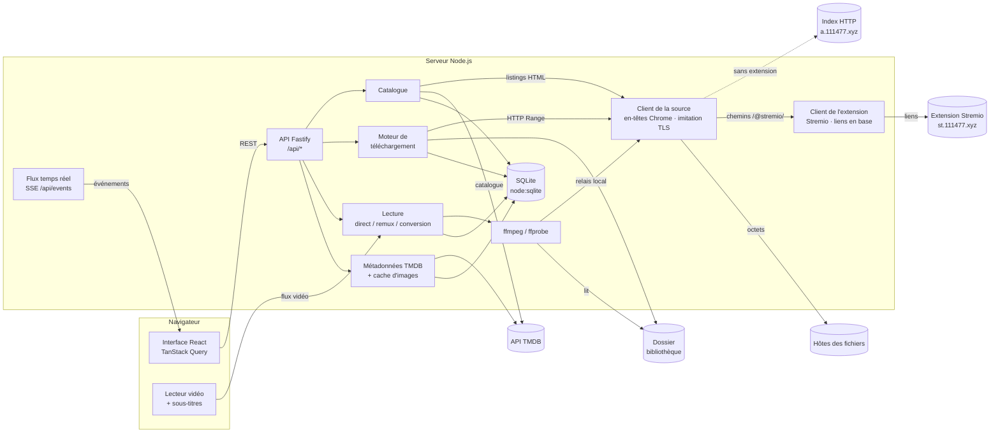
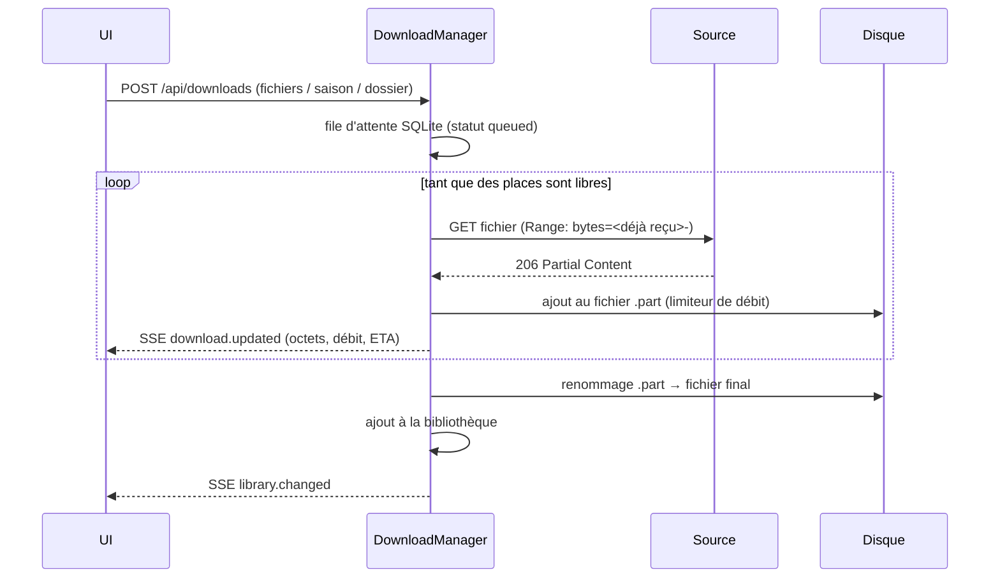

# Architecture de Lumière

## Vue d'ensemble



L'application est un **monorepo npm** :

| Paquet              | Rôle                                                                                                               |
| ------------------- | ------------------------------------------------------------------------------------------------------------------ |
| `apps/server`       | API HTTP, synchronisation du catalogue, téléchargements, lecture, bibliothèque.                                    |
| `apps/web`          | Interface React (SPA) servie par le serveur en production.                                                         |
| `packages/shared`   | Types TypeScript des échanges client/serveur (contrats d'API).                                                     |
| `tools/demo-source` | Source de démonstration : index HTTP façon nginx, vidéos générées par ffmpeg, faux TMDB, fausse extension Stremio. |

## Serveur (`apps/server/src`)

```
main.ts              démarrage, arrêt propre (SIGINT/SIGTERM)
app.ts               instance Fastify : validation zod, gestion d'erreurs, routes /api, interface statique
container.ts         racine de composition : création et câblage de tous les services
config/env.ts        variables d'environnement validées (zod)
core/                utilitaires transverses (erreurs, logs, bus d'événements, fichiers, Range, asynchrone)
infra/database/      connexion SQLite, migrations versionnées, cache clé/valeur
domain/              fonctions pures : noms de releases, épisodes/saisons, titres, choix de version
modules/
  source/            client de la source (transports standard / imitation de Chrome, cookies),
                     relais local pour ffmpeg, analyseur générique de listings
    stremio/         client d'une extension Stremio (manifeste, liens d'un film ou d'un
                     épisode, gardés en base) et chemins virtuels /@stremio/… des fichiers
  catalog/           synchronisation films/séries, recherche, fiches, structure saisons/épisodes ;
                     addon-catalog.ts : titres TMDB ↔ extension (identifiant IMDb, saisons)
  metadata/          client TMDB, rapprochement des titres, cache des images
  downloads/         file d'attente, moteur de transfert, rangement des fichiers ;
                     episode-queue.ts : épisodes demandés un par un à l'extension
  library/           fichiers locaux, analyse du dossier
  playback/          ffprobe, plan de lecture, sessions, flux ffmpeg, sous-titres, progression
  explorer/          navigation brute dans la source, test de connexion
  availability/      état combiné téléchargement / bibliothèque / visionnage d'un fichier
  settings/          paramètres persistés (modifiables à chaud)
  events/, system/   flux SSE, santé et informations système
```

Chaque module suit le même découpage : **routes** (HTTP + validation zod) → **service**
(règles métier) → **repository** (SQL). Les services reçoivent leurs dépendances par le
constructeur : ils se testent isolément ou ensemble (tests d'intégration avec de faux
serveurs HTTP).

### Extension Stremio (mode par défaut)

Le site a.111477.xyz exige une vérification Cloudflare que seul un vrai navigateur passe ; son
extension Stremio fournit au contraire des liens destinés aux lecteurs vidéo. Quand une
extension est renseignée (`stremioAddonUrl`) :

1. Le catalogue vient de **TMDB** (`tmdb-catalog.ts` : tendances, populaires, à l'affiche,
   mieux notés, et toute recherche). La liste du site n'est jamais lue.
2. À l'ouverture d'un **film**, `AddonCatalog` obtient son identifiant IMDb (TMDB
   `external_ids`, demandé une fois puis gardé dans `titles.imdb_id`) et demande à l'extension
   `GET <base>/stream/movie/tt….json`. Chaque fichier proposé reçoit un **chemin virtuel**
   stable, `/@stremio/movie/tt1677720/<fichier>` (`stremio/virtual-path.ts`) : téléchargements,
   bibliothèque, reprise de lecture et relais ffmpeg le manipulent comme un chemin de la
   source. Le titre est rattaché à son dossier virtuel (`/@stremio/movie/tt1677720/`).
3. Pour une **série**, saisons et épisodes viennent de TMDB ; aucun lien n'est demandé pour
   afficher la fiche. Les liens d'un épisode (`…/stream/series/tt…:S:E.json`, chemins
   `/@stremio/series/tt…/SxE/<fichier>`) ne sont demandés qu'à la lecture, au téléchargement,
   ou à l'ouverture de « Choisir une version ». Une référence `{ type: 'episode', titleId,
season, episode }` permet de lancer la lecture (ou l'épisode suivant) sans connaître le
   fichier : le serveur prend la copie locale, sinon la version préférée.
4. Les réponses sont **gardées en base** (`kv_cache`, 12 h ; 3 min si vide ou limitée) avec le
   lien de chaque fichier. `SourceClient.openFile` résout le lien au moment de lire les
   octets ; un lien refusé (401/403/404/410) est redemandé une fois. Chez 111477, chaque lien
   consomme un jeton d'une réserve par adresse IP : ces règles évitent d'en gaspiller.
5. « Télécharger la saison » met les épisodes dans `EpisodeQueue` : une demande toutes les
   1,2 s (limite de 10 requêtes par 10 s), épisodes déjà téléchargés ignorés, lot abandonné dès
   que l'extension signale sa limite ; le bilan est diffusé (`downloads.notice`).

### Synchronisation du catalogue (sans extension)

1. `CatalogService` lit `/movies/` et `/tvs/` via `SourceClient` (cache mémoire, requêtes
   mutualisées) ; l'analyseur `listing-parser.ts` transforme la page en entrées
   `{ nom, dossier ?, taille, date }`. `SourceClient` choisit le transport (`transport.ts`) :
   requête Node.js avec les en-têtes exacts d'une navigation Chrome (`node-http.ts`), puis,
   si la source filtre les robots (403), imitation complète de Chrome avec **impit**. Choix
   mémorisé par origine.
2. Chaque entrée devient un titre (`title-parser.ts` : « Titre (Année) », nom de release…),
   inséré/actualisé en une transaction ; les titres disparus sont retirés.
3. `MetadataService` enrichit progressivement les titres (TMDB) en arrière-plan, et à la
   demande lorsqu'une affiche ou une fiche est affichée.
   Si la liste complète est illisible (trop volumineuse, bloquée…) ou si l'utilisateur le
   choisit, le catalogue vient de **TMDB** et `source-resolver.ts` cherche le dossier d'un
   titre sur la source à l'ouverture de sa fiche, d'après les conventions « Titre (Année) » /
   « Titre » (`domain/folder-names.ts`) ; le résultat est mémorisé (`titles.source_status`).
4. La structure d'une série (saisons/épisodes) est calculée à l'ouverture de la fiche, en
   explorant les dossiers de saison en parallèle (`series-structure.ts`).

### Téléchargement



Pause, annulation et arrêt du serveur interrompent proprement le transfert (AbortController) ;
au redémarrage, les téléchargements interrompus repartent de l'octet où ils s'étaient arrêtés.

### Lecture

1. Le navigateur détecte ses codecs (`capabilities.ts`) et demande une session :
   `POST /api/playback/sessions { media, capabilities, audioTrack? }`.
2. Le serveur résout le média (copie locale prioritaire), l'analyse avec **ffprobe** et
   calcule un plan (`planner.ts`) : **direct**, **remux** (vidéo copiée) ou **conversion**
   (H.264 ou VP9 selon le navigateur, tonemapping HDR).
3. Le lecteur lit `GET /api/playback/sessions/:id/stream` :
   - direct : fichier local ou relais de la source avec prise en charge de `Range` ;
   - remux/conversion : ffmpeg produit un MP4 fragmenté à partir de `?start=<secondes>` ;
     un fichier distant est lu par le **relais local** `/api/internal/source` (jeton aléatoire),
     pour que ffmpeg passe par la même connexion que le reste de l'application ;
     chaque chargement porte un identifiant (`&stream=<id>`) et
     `GET …/streams/:id/origin` donne l'instant réel de départ (image clé atteinte en
     recopie vidéo, lue par ffmpeg dans le même passage) pour rester synchronisé.
4. Sous-titres : `GET …/subtitles/:piste` renvoie du WebVTT (extraction ffmpeg ou conversion
   SRT/ASS), affiché par le lecteur.
5. La position est enregistrée régulièrement (`POST …/progress`) : reprise, « Reprendre la
   lecture », marquage « vu ».

## Modèle de données (SQLite)

| Table               | Contenu                                                                          |
| ------------------- | -------------------------------------------------------------------------------- |
| `titles`            | Films et séries du catalogue + métadonnées TMDB (affiche, résumé, genres JSON…). |
| `catalog_sections`  | État de synchronisation des sections films/séries.                               |
| `downloads`         | File et historique des téléchargements (statut, octets, erreurs).                |
| `library_items`     | Fichiers présents dans la bibliothèque locale.                                   |
| `watch_progress`    | Position de lecture par média (clé = chemin distant ou fichier local).           |
| `settings`          | Paramètres modifiés depuis l'interface.                                          |
| `kv_cache`          | Cache des réponses TMDB (saisons…) et des liens de l'extension Stremio.          |
| `schema_migrations` | Migrations appliquées.                                                           |

## API REST (principales routes)

| Méthode   | Route                                            | Rôle                                                         |
| --------- | ------------------------------------------------ | ------------------------------------------------------------ |
| GET       | `/api/home`                                      | Accueil (titres mis en avant, ajouts récents).               |
| GET       | `/api/titles?kind&q&sort&genre&page`             | Catalogue paginé.                                            |
| GET       | `/api/titles/:id`                                | Fiche complète (versions, saisons, épisodes, disponibilité). |
| GET       | `/api/titles/:id/episodes/:saison/:épisode`      | Versions d'un épisode (demandées à l'extension Stremio).     |
| GET       | `/api/titles/:id/artwork/:type`                  | Affiche/fond (recherche TMDB à la demande).                  |
| GET       | `/api/images/:taille/:fichier`                   | Image TMDB mise en cache.                                    |
| POST      | `/api/catalog/refresh`                           | Relire la source.                                            |
| GET       | `/api/explorer?path=`                            | Contenu d'un dossier de la source.                           |
| GET/POST  | `/api/downloads`                                 | Liste / ajout de fichiers.                                   |
| POST      | `/api/downloads/title`, `/api/downloads/folder`  | Film, épisode, saison, série, dossier complet.               |
| POST      | `/api/downloads/:id/pause` · `resume` · `cancel` | Contrôle d'un téléchargement.                                |
| GET       | `/api/library`, `/api/library/:id/file`          | Bibliothèque, enregistrement d'un fichier.                   |
| POST      | `/api/playback/sessions`                         | Création d'une session de lecture.                           |
| GET       | `/api/playback/sessions/:id/stream?start=`       | Flux vidéo.                                                  |
| GET       | `/api/playback/continue`                         | Lectures en cours.                                           |
| GET/PATCH | `/api/settings`                                  | Paramètres.                                                  |
| POST      | `/api/settings/test-addon`                       | Test d'une adresse d'extension Stremio (manifeste).          |
| GET       | `/api/events`                                    | Flux temps réel (Server-Sent Events).                        |
| GET       | `/api/system`, `/api/health`                     | État du système.                                             |
| GET       | `/api/internal/source?path&token`                | Relais de la source réservé à ffmpeg/ffprobe (jeton requis). |

## Interface (`apps/web/src`)

```
main.tsx, router.tsx    point d'entrée, routes (pages chargées à la demande)
styles/                 jetons de design, matériau Liquid Glass, fond d'ambiance
design/glass/           moteur du verre : préférences d'apparence, réfraction (cartes de
                        déplacement + filtres SVG), lumière dynamique, garde-fou de fluidité
design/ambient/         palette extraite des illustrations, fond d'ambiance
api/                    client HTTP typé, hooks TanStack Query, abonnement SSE
components/ui/          boutons, badges, barres de progression, dialogues, menus, contrôles
                        segmentés, interrupteurs…
components/layout/      barre latérale flottante, barre d'outils, barre d'onglets mobile
components/media/       affiches, rangées défilantes, badges de release
features/               une page par dossier : home, catalog, title, downloads, library,
                        explorer, settings, search, player
lib/                    formatage (tailles, durées), codecs du navigateur, WebVTT
```

Le cache TanStack Query est la source de vérité côté client ; le flux SSE y injecte la
progression des téléchargements et invalide les vues concernées (bibliothèque, fiches,
catalogue) quand le serveur signale un changement.

Le design system (couches, matériaux, jetons, accessibilité, prise en charge des navigateurs)
est décrit dans [DESIGN.md](DESIGN.md). Les fonctions pures de l'interface (réfraction,
détection des navigateurs, préférences, palette, navigation) sont couvertes par des tests
Vitest (`apps/web/src/**/*.test.ts`).
